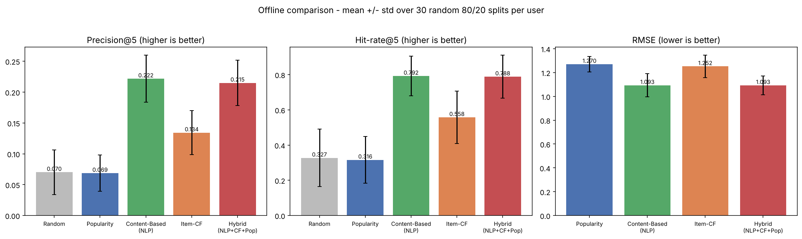
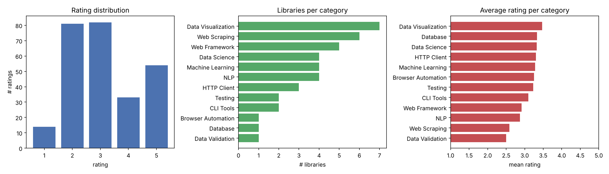
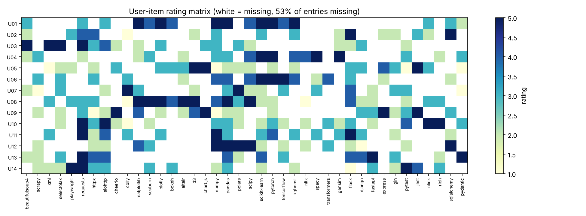

# Open-Source Software Library Recommender

**CS467 Advanced Artificial Intelligence – Mini-Project MP-C02 (Assignment 15)**

| | |
|---|---|
| **Student** | Hoàng Minh Đức |
| **Student ID / Section** | 29216562284 / CS467C (No. 02) |
| **Instructor** | Puri Vikram |
| **Project title** | Open-Source Software Library Recommender |
| **Domain** | Developer ecosystem and package discovery |

---

## 1. Problem statement

Developers choosing an open-source package face hundreds of options. This project builds a small
recommender that combines **NLP on README descriptions / topic tags** with **developer ratings** to:

1. answer a free-text need ("lightweight python library for web scraping and html parsing"),
2. suggest alternatives to a library the developer already knows,
3. personalise suggestions for a developer from their rating history,
4. handle **cold start** – a brand-new library with zero ratings must still be recommendable.

## 2. Dataset (`data/`)

| File | Content |
|---|---|
| `items.csv` | **40 libraries** – `item_id, package_name, language, category, readme_summary, topic_tags` (12 categories; 32 Python, 5 JavaScript, 2 Go, 1 Rust) |
| `ratings.csv` | **264 ratings by 14 developers** – `user_id, item_id, rating (1-5), dev_comment` |

* Every developer rated **16–24 libraries** (≥ 4–6 required); the user-item matrix is **52.9 % missing** (within the 40–65 % target), see `results/rating_matrix.png`.
* **Source / honesty note:** the 40 libraries are real, well-known projects; each `readme_summary` is a short *original paraphrase* of the project's public README / website description (e.g. PyPI, GitHub, project docs) – no text is copied verbatim. The **ratings and comments are synthetic**: 14 developer personas (data scientist, backend dev, scraping engineer, NLP researcher, frontend dev, QA engineer, …) were simulated with preferred categories/languages, a popularity bias and Gaussian noise (`scripts/make_dataset.py`, fixed seed 467). They are not real user reviews.

## 3. NLP and recommendation methods

### NLP pipeline (`src/nlp_pipeline.py`)
1. **Cleaning** – lowercase, hyphens/underscores → spaces, punctuation removal, whitespace squeeze.
2. **Tokenization + stop-words** – whitespace tokens; English stop-words plus domain fillers (`library`, `package`, …).
3. **Light stemmer** – tiny suffix-stripper so *scraping / scraper / scrape* and *parsing / parser* match (same code for documents and queries).
4. **TF-IDF (unigrams + bigrams)** – `sublinear_tf`, L2-normalised. A document = README summary + category + language + topic tags (tags repeated twice so curated tags weigh more). Bigrams never cross a sentence/tag boundary. Vocabulary: 861 features.
5. **Query vectorization** – `NLPPipeline.vectorize_query()` projects any free text or new item description into the *same* vocabulary (this is what makes cold start work).
6. **Key capability phrases / explanations** – `key_phrases()` lists the top TF-IDF phrases of a library; `shared_keywords()` lists the terms contributing most to a cosine score (stems are mapped back to readable words), which is printed as *"matched on: …"*.

### Recommenders (`src/recommender.py`)
| # | Method | How it works |
|---|---|---|
| 1 | **Popularity baseline** | Weighted rating `WR = v/(v+m)·R + m/(v+m)·C` (v = #ratings, R = item mean, C = global mean, m = 2); items with < 2 ratings are not eligible; items the user already rated are filtered out. |
| 2 | **NLP content-based** | Cosine similarity of TF-IDF vectors. (a) free-text query, (b) item-to-item, (c) user profile = Σ (rating−3)·tfidf(liked items). Returns Top-5 + score + matching keywords. |
| 3 | **Hybrid (extension)** | `score = 0.4·content + 0.4·item-CF + 0.2·popularity`, each component min-max normalised over candidates. Item-CF = adjusted-cosine item-item similarity on user-mean-centred ratings with co-rater shrinkage. A component that is unavailable for an item (e.g. cold-start item) is dropped and the remaining weights are re-normalised for that item. For text queries the hybrid blends content similarity with a small (0.1) popularity prior. |

An **Item-CF only** model and a **Random** baseline are also evaluated as ablation / sanity reference.

## 4. Installation and run commands

```bash
git clone https://github.com/<your-github-username>/cs467-miniproject-29216562284.git
cd cs467-miniproject-29216562284
python -m venv venv && source venv/bin/activate      # Windows: venv\Scripts\activate
pip install -r requirements.txt

python src/main.py --save                 # 3 required test cases (+ writes results/sample_outputs.txt)
python src/main.py --user U03             # Top-5 for developer U03 (popularity vs content vs hybrid)
python src/main.py --query "async http client for python"
python src/main.py --similar seaborn      # 5 alternatives to a library (name or id)
python src/evaluate.py                    # offline evaluation + charts in results/
python scripts/make_dataset.py            # (optional) regenerate the CSV files
```
Python 3.10+; tested on Python 3.12.

## 5. Sample outputs for the 3 required test cases
Full output: [`results/sample_outputs.txt`](results/sample_outputs.txt).

### Test 1 – Need query
`lightweight python library for web scraping and html parsing`

| Rank | NLP content-based | score | matched on |
|---|---|---|---|
| 1 | beautifulsoup4 | 0.574 | parsing, html, lightweight python, web scraping |
| 2 | selectolax | 0.419 | scraping, html parsing, lightweight, web |
| 3 | cheerio | 0.384 | web scraping, html parsing |
| 4 | lxml | 0.369 | html parsing, web scraping, python |
| 5 | scrapy | 0.187 | scraping, web, python |

The hybrid gives the same top-4 and then `flask` (its popularity prior and "lightweight / web / python" overlap lift it above scrapy) – a small example of popularity adding noise to a precise text query.

### Test 2 – Similar-package test (`matplotlib` → 5 alternatives)

| Rank | Content-based | score | Hybrid | score |
|---|---|---|---|---|
| 1 | plotly | 0.250 | plotly | 0.883 |
| 2 | bokeh | 0.230 | bokeh | 0.759 |
| 3 | d3 | 0.201 | seaborn | 0.744 |
| 4 | chart.js | 0.189 | d3 | 0.693 |
| 5 | seaborn | 0.169 | altair | 0.620 |

All alternatives are from the *Data Visualization* category. The hybrid additionally blends in co-rating similarity, which moves the Python plotting libraries seaborn and altair up and pushes chart.js out of the Top-5.

### Test 3 – Cold start
A new library **`pagepick`** (zero-dependency python HTML parser/scraper with CSS selectors, **0 ratings**) is added at run time using only its text description:

* Nearest existing libraries: **selectolax (0.711)**, beautifulsoup4 (0.383), cheerio (0.350), lxml (0.267), scrapy (0.187) → all scraping/parsing libraries.
* For the need-query of Test 1 it enters the content-based Top-5 at **rank 2** (score 0.552) and is **rank 1** in the hybrid list.
* The **Popularity baseline cannot recommend it** (needs ≥ 2 ratings) – this is exactly the cold-start gap that the NLP vectors fill.
* In the hybrid for a scraping-focused developer (U03) it is ranked #1, with `content=1.00, cf=n/a, popularity=n/a`.
* Automatic verification printed by `main.py`: **PASS**.

## 6. Evaluation

**Protocol (`src/evaluate.py`):** per-developer hold-out of ~20 % of ratings (min. 2 per developer), fitted on the training part only; a hidden item is *relevant* if rating ≥ 4; Top-5 recommendations are drawn from items the developer did not rate in training. Because the data is tiny, the experiment is **repeated on 30 random splits** and reported as mean ± std. RMSE/MAE are computed on all hidden ratings.

| Method | Precision@5 | Recall@5 | Hit-rate@5 | RMSE | MAE |
|---|---|---|---|---|---|
| Random (sanity) | 0.070 ± 0.036 | 0.224 | 0.327 | – | – |
| Popularity baseline | 0.069 ± 0.029 | 0.223 | 0.316 | 1.270 | 1.068 |
| **NLP content-based** | **0.222 ± 0.038** | **0.685** | **0.792** | **1.093** | **0.877** |
| Item-CF only (ablation) | 0.134 ± 0.036 | 0.428 | 0.558 | 1.252 | 1.009 |
| Hybrid (NLP + CF + Pop) | 0.215 ± 0.037 | 0.684 | 0.788 | **1.093** | 0.889 |

### Charts (`results/`)




**Reading the results**
* Popularity is no better than random here: developers in this data set have *different* tastes (personas), so a global "best average" list is a poor fit for any individual.
* NLP content-based is ~3× better than the baseline in Precision@5 and clearly lower in RMSE/MAE.
* Item-CF alone is better than popularity but weak: with 14 developers there are very few co-ratings per item pair.
* The **hybrid is statistically on par with content-based** (0.215 vs 0.222, difference far inside one std), *not* better. On a weight sweep with disjoint random seeds (100–114) Precision@5 stayed between 0.225 and 0.236 for very different weights, i.e. the result is insensitive to the weights, and the content signal dominates. Its real advantage is robustness: it handles cold-start items and cold-start users (falls back to popularity) and uses collaborative signal when more ratings are available.

## 7. Short reflection

**What worked well**
* TF-IDF unigrams + bigrams on README text and tags is a strong, cheap signal for this domain; explanations ("matched on: html parsing, web scraping") come directly from the vector overlap.
* Using one shared vectorizer for items, queries and new items makes cold start trivial and testable.
* Repeating the evaluation over 30 splits shows how noisy a single split on 14 users would be.

**Limitations**
* **Small, synthetic data:** 40 libraries, 14 simulated developers. The simulated tastes follow categories/languages, which naturally favours content-based methods; results would differ on real reviews. Precision@5 values are low in absolute terms because each user has only ~3–5 relevant hidden items.
* **No semantic understanding:** TF-IDF only matches words (e.g. "scrape" vs "crawl" are different terms), unlike embeddings.
* **Cold-start scoring:** because unavailable components are dropped and weights re-normalised, a cold-start item can receive a very high hybrid score (1.0 in the demo) from content alone, with no evidence about real quality; a confidence discount would be sensible in production.
* **Hybrid weights** are fixed by hand; popularity can add noise to precise text queries (e.g. `flask` at rank 5 in Test 1).
* Library comparisons ignore maintenance activity, licence and download counts, which matter in practice.

**Possible future work:** sentence-embedding vectors, real GitHub/PyPI metadata (stars, downloads, release recency), learning hybrid weights, using `dev_comment` sentiment as an extra signal.

## 8. Project structure

```
cs467-miniproject-29216562284/
├── README.md
├── requirements.txt
├── .gitignore
├── data/            items.csv, ratings.csv
├── scripts/         make_dataset.py        (regenerates the CSV files, seed 467)
├── src/             nlp_pipeline.py, recommender.py, evaluate.py, main.py
└── results/         sample_outputs.txt, evaluation_*.csv/txt,
                     metrics_comparison.png, data_overview.png, rating_matrix.png
```

## 9. Academic integrity / references
* Library descriptions are paraphrased from the public documentation of the respective open-source projects (PyPI / GitHub pages).
* Methods follow the course material: TF-IDF + cosine similarity, popularity baseline (IMDB-style weighted rating), item-based collaborative filtering (adjusted cosine), weighted hybrid; evaluation with Precision@K, RMSE and MAE.
* Libraries used: numpy, pandas, scipy, scikit-learn (`TfidfVectorizer`), matplotlib.
